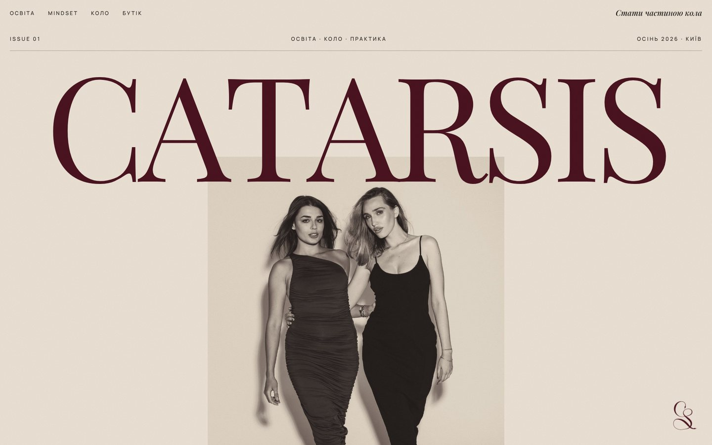

# CATARSIS

Концепт-проєкт: сайт жіночого освітнього клубу у форматі глянцевого журналу.

## Відкрити сайт

- **[Журнал Issue 01](https://zinchenkoanton11.github.io/catarsis/journal/)** — сам сайт: обкладинка, розвороти, бутік SI-POINTS, таємний поверх
- **[Кейс](https://zinchenkoanton11.github.io/catarsis/)** — задача, ідея, айдентика, механіки й технічні рішення

## Що всередині

- `index.html` — сторінка-кейс
- `journal/` — сайт-журнал
- `img/` — скриншоти для кейсу

HTML, CSS і JavaScript без бібліотек, графіка в SVG. Бренд, люди на фото й події вигадані.
